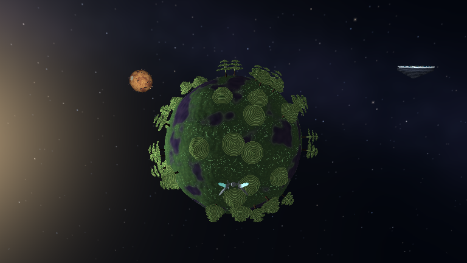
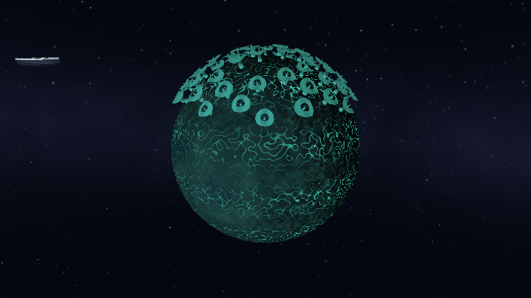

# Nadir

### Observatorio de mundos imposibles

Seis mundos en movimiento, una nave de exploración y una ruta hacia el núcleo galáctico. **Nadir** construye cada imagen mediante un rasterizador escrito en Rust que se ejecuta en CPU: desde las transformaciones y el recorte de triángulos hasta la profundidad, la iluminación y los materiales procedurales.



**Autor:** sallco · **Modalidad:** individual · **Curso:** Gráficas por Computadora, Universidad del Valle de Guatemala.

[Demostración en video](docs/video/nadir.mp4) · [Arquitectura](docs/ARQUITECTURA.md) · [Evaluación](docs/EVALUACION.md) · [Recursos](docs/RECURSOS.md)

## La experiencia

La exploración comienza frente a Mneme. La nave puede aproximarse, rodear el planeta y alejarse sin cambiar de escena. La asistencia local facilita maniobrar cerca de las superficies; el impulso de crucero permite recorrer el sistema. Las órbitas, la rotación, la gravedad y los materiales continúan evolucionando durante el vuelo.

| Mundo | Identidad |
| --- | --- |
| **Mneme** | Bosque de árboles anulares, suelo oscuro y redes bioluminiscentes animadas. |
| **Obsidia** | Corteza volcánica deformada, agujas de basalto y corrientes térmicas en grietas de lava. |
| **Prisma** | Hielo fracturado, cristales facetados y respuesta especular con mapeo de normales. |
| **Artaud** | Gigante de bandas atmosféricas, vórtice localizado y anillos inclinados. |
| **Palimpsesto** | Dunas minerales, interferencias luminosas y monolitos orientados sobre la superficie. |
| **Tierra Plana** | Disco de océanos y continentes, relieve continental, nubes, borde helado y estratos rocosos inferiores. |

| Mneme | Obsidia |
| --- | --- |
|  |  |
| **Prisma** | **Artaud** |
|  |  |
| **Palimpsesto** | **Tierra Plana** |
|  |  |

**Umbra** ocupa una región distinta del sistema planetario. El botón de viaje o la tecla `G` activa una secuencia de warping y conduce al agujero negro supermasivo del núcleo galáctico. Allí se conserva el vuelo libre. Un segundo salto devuelve la nave al sistema, cuya simulación continúa durante la expedición.


Las escalas, velocidades y fenómenos visuales se eligieron para una experiencia legible e interactiva. La representación del agujero negro utiliza una aproximación artística en CPU; no integra ecuaciones relativistas.

## Compilación y ejecución

Verificado en Linux con **Rust 1.99.1**, Cargo y Raylib para Rust 5.5.1. La primera compilación necesita acceso a crates.io, CMake, compilador C/C++, Clang/libclang y bibliotecas de desarrollo de OpenGL y X11, incluyendo Xrandr, Xinerama, Xcursor y Xi. La ventana requiere una sesión gráfica; en Wayland se utiliza XWayland.

```bash
git clone https://github.com/sallco/PROY3-GRAFICAS.git
cd PROY3-GRAFICAS
cargo build --release --locked
cargo run --release --locked
```

Se recomienda la compilación **release**. La ventana mide 1280 × 720; el framebuffer se calcula a 768 × 432 y se escala para su presentación. Los recursos y la configuración predeterminada se resuelven desde el directorio del proyecto incorporado durante la compilación.

El ratón se captura con `C`; las flechas permiten orientar la nave desde el inicio. El botón de viaje funciona con el cursor libre.

## Controles

| Entrada | Acción |
| --- | --- |
| `W` / `S` | Empuje longitudinal hacia delante o atrás. |
| `A` / `D` | Traslación lateral. |
| `Espacio` / `Ctrl izquierdo` | Traslación vertical. |
| Flechas o ratón capturado | Cambiar orientación. |
| `Q` / `E` | Alabeo. |
| `Shift izquierdo` | Impulso de crucero; velocidad máxima de 45 unidades/s en vuelo libre. |
| `X` | Frenado progresivo. |
| `F` | Activar o desactivar asistencia local cerca del planeta más próximo. |
| `Tab` | Seleccionar el destino indicado en pantalla; no teletransporta la nave. |
| `G` o botón superior | Viajar a Umbra o regresar. |
| `C` | Capturar o liberar el ratón. |
| `P` | Pausar la simulación; la orientación permanece disponible. |
| `H` | Mostrar u ocultar ayuda. |
| `R` | Recargar configuración y restablecer el vuelo. |
| `Esc` | Salir. |

Para rodear un planeta, activar `F`, orientar la nave hacia su superficie y utilizar `A`/`D` para recorrerla lateralmente. `Espacio`/`Ctrl` regulan la componente radial de movimiento. La asistencia ajusta velocidad y referencia de control; no pilota automáticamente.

[Ver la interfaz con ayuda y métricas](docs/imagenes/interfaz.png).

El indicador de distancia radial usa la distancia al centro menos el radio nominal. En Tierra Plana es una referencia de navegación, no una medida de altura sobre el disco.

### Instrumentación

| Tecla | Comparación |
| --- | --- |
| `F3` | Tiempo de CPU, FPS de presentación, resolución, objetos, triángulos y fragmentos. |
| `F4` | Activar/desactivar LOD; al desactivarlo todos los mundos usan detalle alto. |
| `F5` | Activar/desactivar descarte de objetos por frustum. |
| `F6` | Activar/desactivar mapeo de normales. |

Las métricas permiten demostrar que las optimizaciones modifican el trabajo del rasterizador. Los anillos y copas anulares son geometría decorativa y no tienen colisión; los cuerpos y modelos de superficie sí emplean volúmenes conservadores.

## Configuración y demostración técnica

Los parámetros se encuentran en [`config/scene.toml`](config/scene.toml): semilla, resolución interna, radio estelar, intensidad del shader, radios planetarios, órbitas, velocidades, inclinación y cantidad de instancias.

```bash
cargo run --release --locked -- --config config/scene.toml
```

Para demostrar un cambio, editar un parámetro y presionar `R`. La nueva escena se aplica después de validar el archivo y reconstruir sus recursos. Ante un error de configuración se conserva la escena anterior y se muestra el motivo. La recarga correcta restablece el vuelo y el tiempo; no es una migración del estado actual.

Ejemplos: cambiar `seed` de 42 a 43 altera la distribución; modificar `orbit_speed` cambia la velocidad orbital; ajustar `shader_intensity` modifica la emisión; modificar un `radius` cambia el cuerpo y sus límites de protección. La validación rechaza órbitas cuyos volúmenes puedan superponerse.

## Evidencia reproducible

```bash
# Capturas a tiempos y cámaras fijos, sin abrir ventana.
cargo run --release --locked -- --export-captures --output output/capturas

# Cuatro combinaciones de LOD/descarte; guarda un CSV.
cargo run --release --locked -- --benchmark --output output/mediciones

# Exportar los cuatro modelos de superficie a OBJ.
cargo run --release --locked -- --export-models --output output/modelos

# Generar el video de 96 segundos; requiere FFmpeg y DejaVu Sans en Linux.
cargo run --release --locked -- --record-demo --output output/nadir.mp4
```

El [video incluido](docs/video/nadir.mp4) se genera con el mismo renderer. Sus primeros 46 segundos utilizan entradas calculadas para el controlador de vuelo: aproximación, vuelta completa a Mneme y alejamiento continuo. Continúa con un montaje de los otros mundos y el viaje de ida y vuelta a Umbra. Los rótulos y la codificación del video se aplican con FFmpeg. Este recorrido reproducible complementa la ejecución interactiva.

## Verificación

```bash
cargo fmt --check
cargo test --locked
cargo clippy --locked --all-targets -- -D warnings
cargo build --release --locked
```

Las **25 pruebas automatizadas** cubren clipping, profundidad entre objetos, recursos, generación de geometría, semillas, orientación de instancias, equivalencia temporal, gravedad, colisiones, pausa, viaje de ida y vuelta y equivalencia de imagen con/sin descarte.

La nave de vuelo conserva el modelo original y reduce sus **116 480 triángulos a 3261**. La generación puede repetirse con Blender:

```bash
blender --background --python scripts/optimizar_nave.py
```

Los resultados de rendimiento, sus condiciones y sus límites se detallan en [arquitectura](docs/ARQUITECTURA.md); las muestras individuales están en [el CSV](docs/evidencia/benchmark.csv). La velocidad depende de la resolución, el encuadre y el equipo.

## Autoría y recursos

Proyecto individual de **sallco** (`dcalderon918@gmail.com`): nave, implementación, materiales, modelos procedurales, integración y documentación. La esfera inicial es un recurso geométrico proporcionado para el curso. No se necesitan imágenes de texturas ni paquetes artísticos descargados.

Se utilizó asistencia de IA en la planificación, implementación, revisión y documentación. Esta declaración se incluye conforme a las especificaciones de entrega; no atribuye coautoría académica. El código y los algoritmos deben poder explicarse durante la evaluación.

La procedencia de archivos, las dependencias y los procedimientos de generación se describen en [recursos](docs/RECURSOS.md).
