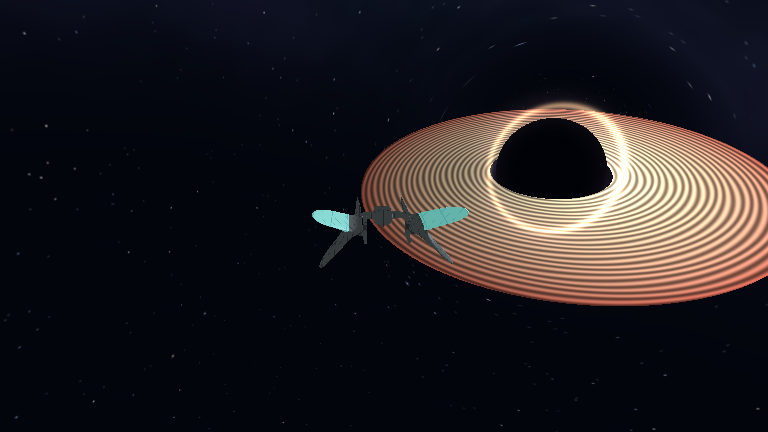

# Recursos, autoría y reproducción

## Autoría

**sallco — dcalderon918@gmail.com** es el único autor académico del proyecto. La nave original es un modelo propio. La implementación integra pipeline, controles, simulación, materiales, geometría procedural, presentación y documentación.

## Inventario

| Recurso | Procedencia y uso |
| --- | --- |
| `assets/models/nave-original.obj` | Modelo original propio, conservado sin modificaciones: 58 384 vértices en el archivo y 116 480 triángulos. El cargador omite 60 vértices sin caras al construir la malla. |
| `assets/models/nave-vuelo.obj` | Derivación optimizada del mismo modelo: 1647 vértices y 3261 triángulos. Mantiene el original en el repositorio. |
| `assets/models/sphere.obj` | Esfera inicial proporcionada para el curso: 98 vértices y 192 triángulos. El programa normaliza y subdivide su geometría. |
| `assets/models/superficie/*.obj` | Árbol de copas escalonadas, basalto, cristal y pórtico de observatorio (`monolito.obj`) generados mediante código propio. Son exportaciones de referencia; la aplicación construye esas mallas al iniciar. |
| Mundos, disco terrestre y anillos | Generación propia en CPU durante la preparación de escena. |
| Materiales, mapa normal, resplandor solar y cielo | Generados proceduralmente; no se cargan imágenes externas de textura. |
| `docs/imagenes/*.png` | Imágenes calculadas por el renderer y capturas de la aplicación. |
| Video demostrativo | Adjunto de GitHub enlazado en el README. |
| `docs/evidencia/benchmark.csv` | Mediciones individuales del modo reproducible de rendimiento. |

Los OBJ pueden conservar referencias `mtllib` de su exportación. El renderer ignora esas referencias y asigna materiales propios; no requiere archivos MTL. Blender puede informar que el MTL original no está disponible al ejecutar la optimización; la exportación geométrica no depende de él.

## Comparación de la nave

Ambas imágenes utilizan la misma cámara, transformación y normalización. La versión de vuelo conserva la convención de ejes del original; una prueba de regresión compara sus extensiones por eje.

| Original: 116 480 triángulos | Vuelo: 3261 triángulos |
| --- | --- |
|  |  |

## Dependencias

| Componente | Uso |
| --- | --- |
| Rust / biblioteca estándar | Simulación, estructuras, concurrencia, archivos y proceso de codificación. |
| `raylib` 5.5.1 | Ventana, entrada, interfaz 2D, exportación de imágenes y presentación de framebuffer. |
| `noise` 0.9 | OpenSimplex para materiales, deformación y distribución. |
| `serde` / `toml` | Deserialización y validación de parámetros de escena. |
| Blender | Herramienta de desarrollo para derivar la nave optimizada; no se necesita para ejecutar. |
| FFmpeg / DejaVu Sans | Herramientas opcionales para generar recorridos locales; no se necesitan para el vuelo interactivo. |

Las versiones resueltas y licencias declaradas por las dependencias se encuentran en Cargo.lock y sus paquetes. El repositorio no cambia sus condiciones de distribución.

El museo reutiliza estos mismos recursos y no incorpora modelos artísticos adicionales. Carga la nave original y la optimizada al iniciar para permitir su comparación inmediata.

## Procedimientos reproducibles

```bash
# Optimización del modelo original con Blender.
blender --background --python scripts/optimizar_nave.py

# Exportación de modelos propios de superficie.
cargo run --release --locked -- --export-models --output assets/models/superficie

# Evidencia visual y mediciones.
cargo run --release --locked -- --export-captures --output output/capturas
cargo run --release --locked -- --benchmark --output output/mediciones
cargo run --release --locked -- --record-demo --output output/nadir.mp4
```

La reducción de la nave utiliza decimación con proporción 0,028, triangulación y eliminación de vértices no referenciados en la exportación. El resultado se centra y normaliza al cargarlo, igual que el original para la comparación visual. Distintas versiones de Blender pueden producir una triangulación ligeramente diferente; el OBJ ya incluido es el recurso utilizado por la aplicación.

## Organización del desarrollo

`main` reúne los hitos integrados. Las ramas `feat/*`, `fix/*`, `perf/*`, `test/*`, `style/*` y `docs/*` conservan el trabajo por responsabilidad. Se utilizan integraciones por avance rápido para preservar los commits atómicos.

Los mensajes de commit son de una sola línea en español, con Conventional Commits sin scope. La identidad efectiva es la configuración de Git de sallco; no se incluyen cuerpos ni pies en los commits.
